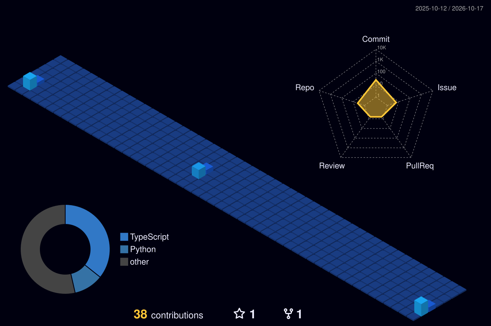

<div align="center">


### Arjun P

[](https://www.linkedin.com/in/arjun-p2005/)
[](mailto:arjunajo2005@gmail.com)
[](https://github.com/arjun2005-web)


</div>

---

## ~/ whoami

```bash
$ cat about.txt
```

Hi, I'm **Arjun**. I build mobile and full-stack apps for civic and public-sector problems, and I like shipping things that real people actually use.

- 🔭 Final-year B.Tech CSE student at JCET, Palakkad, Kerala
- 🌲 Building a React Native app for Kerala Forest Department officers
- 🌊 Working on OceanGuard AI, a fisherman safety and maritime tracking system
- 🎯 Looking for **entry-level full-stack developer** roles, and open to freelance work
- ⚡ Fun fact: I started coding seriously because I wanted to build things that were missing

---

## ~/ toolbox

<div align="center">


</div>

---

## ~/ projects

| Project | What it does |
|---|---|
| 🌲 **Forest Department App** | React Native (Expo) app for officers: field forms, PDF reports, Malayalam support |
| 🌊 **OceanGuard AI** | Fisherman safety and maritime tracking system |
| 🩸 **RapidRed** | Blood donation platform with user, hospital and admin dashboards |

---

## ~/ the numbers

<div align="center">


</div>

---

## ~/ contribution calendar

<div align="center">



</div>

---

## ~/ snake

<div align="center">

<picture>
  <source media="(prefers-color-scheme: dark)" srcset="https://raw.githubusercontent.com/arjun2005-web/arjun2005-web/output/github-snake-dark.svg" />
  <source media="(prefers-color-scheme: light)" srcset="https://raw.githubusercontent.com/arjun2005-web/arjun2005-web/output/github-snake.svg" />
  
</picture>

</div>
